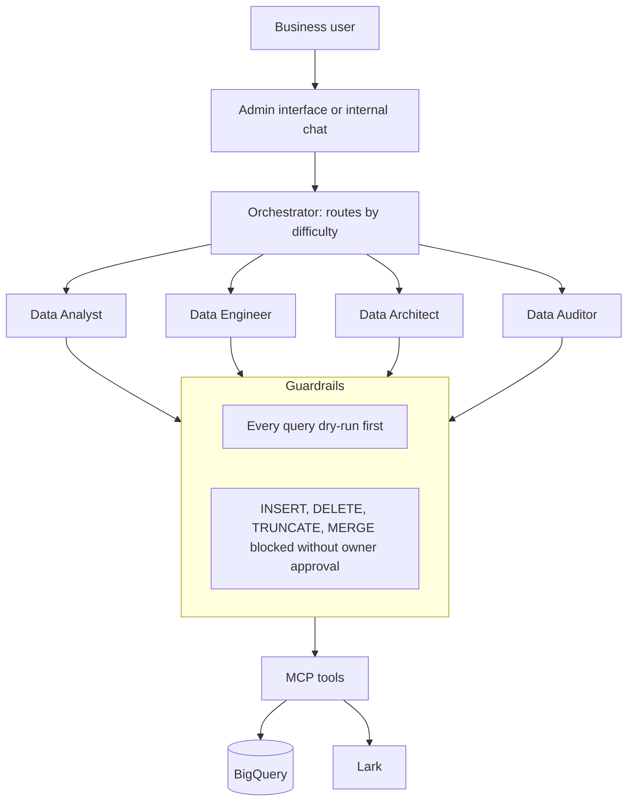

# AI Data Agent for Business Self-Service

> Design write-up of a multi-agent system that lets business users query and audit company data in natural language, safely. **Documentation only — no source code, prompts or company data.**

## Problem

Business users depended on the data team for every question. The goal: let them ask directly, while keeping the data warehouse safe from accidental or unapproved changes.

## Solution

A multi-agent system organised by business function, with an orchestration layer that routes each question by difficulty. Agents reach BigQuery and Lark through **MCP (Model Context Protocol)**, and run under strict guardrails. Built mainly on Claude models.

## What the agents do

- Query data and write SQL
- Audit data quality
- Raise pipeline alerts
- Propose fixes for problems they find
- Produce reports

## Key design decisions

- **Roles mirror real jobs.** Separate agents (Analyst, Engineer, Architect, Auditor) keep prompts focused and behaviour predictable, instead of one agent doing everything.
- **Routing by difficulty.** Simple questions take a cheap, fast path; harder ones go to a stronger path.
- **Safety first.** Every query is dry-run before it runs, so cost and scope are known in advance. Any statement that changes data (`INSERT`, `DELETE`, `TRUNCATE`, `MERGE`) is blocked unless the data owner has approved it.
- **Tools over free-form access.** Agents act only through MCP tools, which keeps what they can do explicit and auditable.
- **Meet users where they work.** Available from an admin interface or as chat inside the internal system.

## Status

In active development.

## Tech stack

Claude · MCP · BigQuery · Lark · Python

## My role

Designed the agent architecture, skills, prompts and tools.

## Related

- [Omnichannel retail data platform on BigQuery](../medallion-retail-data-platform)
